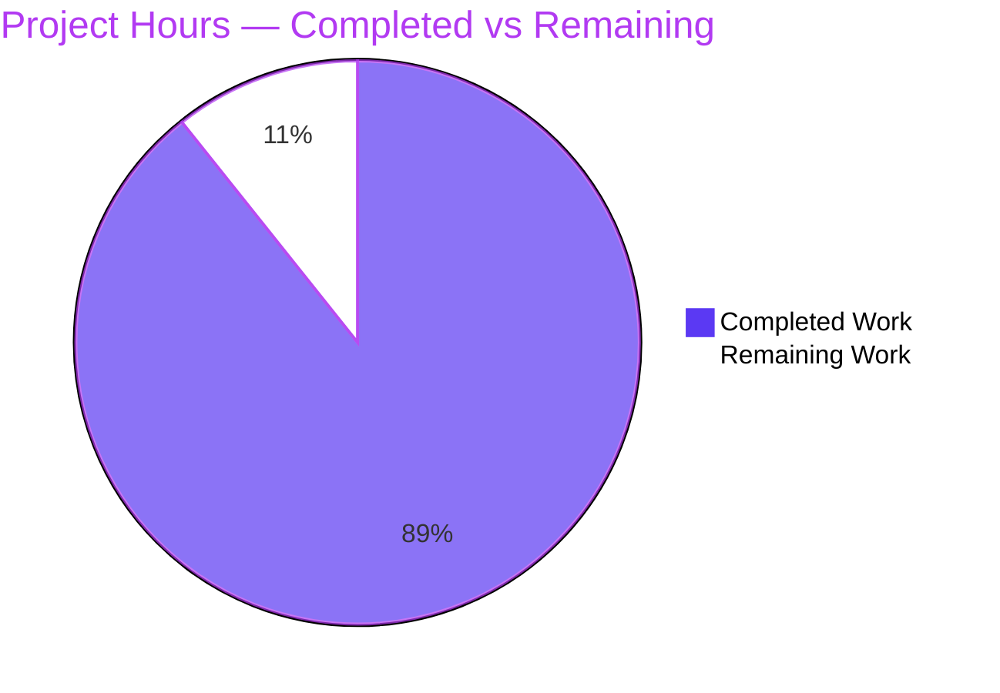
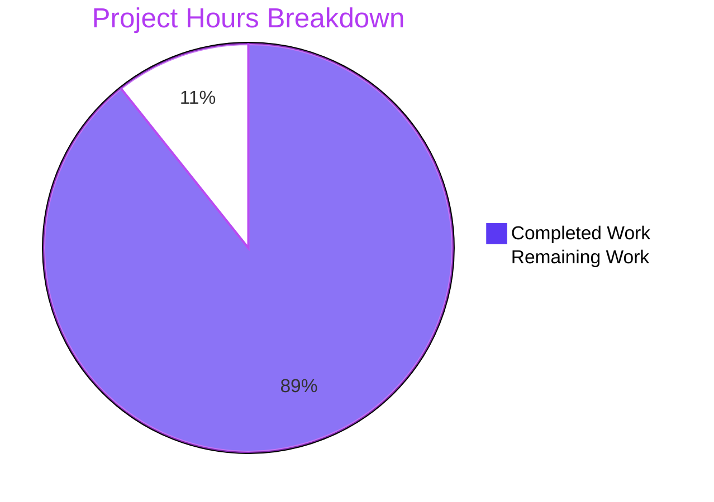
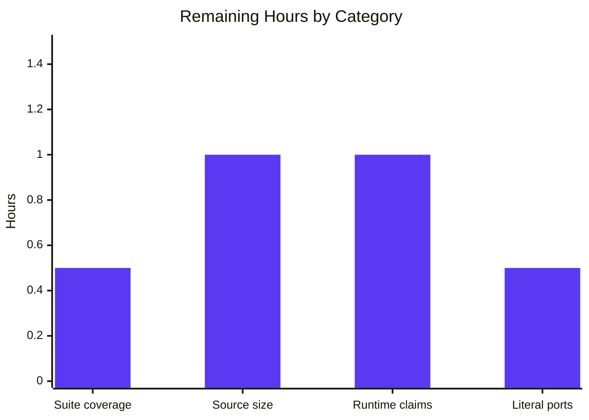

# 1. Executive Summary

## 1.1 Project Overview

A Node.js tutorial around a single HTTP endpoint. `src/app.js` answers `GET` and `HEAD /hello` with the literal `Hello world` as `text/plain; charset=utf-8`, answers every other path and method with `404`, and carries no framework, dependency, database or build step. `src/server.js` binds the operator's address and prints one line naming it; `README.md` walks a reader from prerequisites to a verified response and a clean stop. Its readers are developers learning `node:http`; its value is a reproducible example they can extend in one branch.

## 1.2 Completion Status

**Result: 25.0 hours completed out of 28.0 total hours = 89% complete.** Hours cover the plan's eight deliverables, the endpoint contract, the suite, the tutorial and the verification that proves them.



| Metric | Hours | Basis |
|---|---|---|
| Total Hours | 28.0 | Plan-scoped deliverables plus the path-to-production work it implies |
| Completed Hours (Baseline: Human with agentic-assist) | 25.0 | 31 of 32 requirements fully met and verified on the running server |
| Remaining Hours | 3.0 | One requirement accepted with a caveat plus three verification gaps |

## 1.3 Key Accomplishments

- The `/hello` contract holds on the wire: `200`, `text/plain; charset=utf-8`, `Content-Length: 11`, the exact 11-byte greeting; `HEAD` carries the media type with no body and no length.
- Every other path and method — `CONNECT` included — receives `404` with the 9-byte `Not Found` body.
- Routing reads the pathname only, so queries are ignored and no client-supplied host can choose the route, and an unparsable target gets the same 404 instead of ending the process.
- Fixed-length framing holds over HTTP/1.1 and HTTP/1.0; `HOST`/`PORT` reach the bind with `127.0.0.1`/`3000` defaults, an empty `HOST` still landing on loopback.
- Five contract cases pass on one command against a real socket, releasing their port even when all are filtered out, and a 221-line tutorial quotes outputs that match the shipped code.

## 1.4 Critical Unresolved Issues

Seven items are open: one accepted with a caveat, five behaviours only probes prove, one documentation claim never exercised.

| Issue | Impact | Owner | ETA |
|---|---|---|---|
| Source-size expectation — 1 item: the source is 78 lines against the plan's ~40, and `README.md:193-195` calls it "about forty lines including comments" | Documentation accuracy only; no behaviour, security or performance effect | Engineering owner | 1.0 h |
| Behaviours no test asserts — 5 items: HTTP/1.0 framing, the `CONNECT` 404, unparsable targets, the empty-`HOST` loopback fallback, absolute-form routing | A future edit could break any of them while `npm test` stays green | Engineering owner | 0.5 h |
| Runtime-version claims — 1 item: the tutorial's statements about Node 18/20/23+ | A reader on another release could be misled with no failing test | Documentation owner | 1.0 h |

## 1.5 Access Issues

No access issues identified: no credential, registry access or external service is needed, the install resolves offline, and the project opens only its loopback listener.

## 1.6 Recommended Next Steps

1. **[High]** Decide whether the five probe-only behaviours get assertions, adding them if the five-case contract allows (0.5 h).
2. **[Medium]** Reconcile the source-size expectation — tighten the comments, or record the figure as superseded and fix the tutorial sentence (1.0 h).
3. **[Low]** Exercise the runtime-version statements on a real older and a real newer Node release (1.0 h).
4. **[Low]** Bind the documented `3000` default and the `PORT=4500` override literally, then confirm both release (0.5 h).

# 2. Project Hours Breakdown

## 2.1 Completed Work Detail

| Component | Hours | Description |
|---|---|---|
| Foundation — manifest, lockfile, runtime pin, ignore rules | 2.0 | Six-key `package.json` with both scripts and no dependency field, npm-generated `package-lock.json` at lockfileVersion 3, `.nvmrc` pinned to `22`, four `.gitignore` entries; `npm install --offline` and `npm ci --offline` both resolve nothing and exit 0 |
| Request handler and server factory (`src/app.js`) | 5.0 | Route constants, guarded fixed-base target parse, single method-and-pathname decision, fixed-length response write with the `HEAD` exemption, contract 404 for the method `node:http` routes outside the request listener, and the two mandated rationale comments |
| Process entry point and configuration (`src/server.js`) | 3.0 | `HOST`/`PORT` reads with a falsy loopback default and a numeric port default, `listen`, one startup line built from `server.address()` with IPv6 bracketing, and no server-level `'error'` listener so bind failures surface |
| Contract test suite (`test/hello.test.js`) | 3.0 | Five cases with the specified names and 17 assertions over a real socket, port-0 setup and teardown, and a teardown guard that keeps a fully filtered run a clean no-op |
| Tutorial walkthrough (`README.md`) | 4.0 | 221 lines: what the project is, prerequisites, install, tests, start, call, correct response, stop, port change, extend, troubleshooting, every step quoting the output the reader must see |
| Runtime contract verification | 5.0 | HTTP/1.1 and HTTP/1.0 framing, path and method matrices, `CONNECT`, malformed and unparsable targets, query handling, host independence, configuration overrides and bind diagnostics, all exercised on a running instance |
| Security posture verification | 2.0 | Loopback-only exposure, inert handling of bodies and traversal payloads, response header hygiene, and secret and internal-detail scans across the eight files |
| Readability and rationale comments (partial) | 1.0 | Three precise comment blocks that state reasoning the code cannot show, plus the style conventions; the plan's line figure itself is not met, so this component carries partial credit |
| **Total** | **25.0** | Equals the Completed Hours in Section 1.2 |

## 2.2 Remaining Work Detail

| Category | Hours | Priority |
|---|---|---|
| Reconcile the source-size expectation — tighten the comment blocks in `src/app.js`/`src/server.js`, or record the figure as superseded and correct the tutorial sentence at `README.md:193-195` | 1.0 | Low |
| Verify the tutorial's runtime-version statements on a real older and a real newer Node release, including the reporter-dialect paragraph at `README.md:51,65` | 1.0 | Low |
| Bind the documented default port `3000` and the `PORT=4500` override literally on an ordinary machine, then confirm both ports are released | 0.5 | Low |
| Record the decision on suite coverage for the five probe-only behaviours, and add the assertions if the decision permits it | 0.5 | High |
| **Total** | **3.0** | Equals the Remaining Hours in Section 1.2 and the "Remaining Work" value in Section 7 |

## 2.3 Calculation and Estimate Confidence

**Formula with actual numbers:** `Completed Hours / (Completed Hours + Remaining Hours) × 100` = `25.0 / (25.0 + 3.0) × 100` = `25.0 / 28.0 × 100` = `89.29%`, reported as **89%** in Sections 1.2, 7 and 8.

**Confidence.** High for the eight deliverable files, the endpoint contract and the suite: each was read line by line and exercised on a running instance, so their hours rest on work that is visibly present. Medium for the verification components, whose hours reflect effort rather than artifact volume. High for the remaining estimate in aggregate and lower per item, because the largest remaining item is a documentation-and-comment judgement rather than new functionality. Nothing in the remaining work changes behaviour: 25.0 h of the 28.0 h total is delivered and observable, and the 3.0 h outstanding is reconciliation and verification on hardware and runtimes other than the delivery host.

# 3. Test Results

Every row below is a test or probe that was executed on this branch and whose result was observed. No coverage tool is configured and the project's scope excludes adding one, so no coverage percentage exists to report.

| Area / Category | Framework | Tests | Passed | Failed | Coverage | What This Proves |
|---|---|---|---|---|---|---|
| Endpoint contract suite | `node:test` (`npm test` → `node --test`) | 5 cases, 17 assertions | 5 | 0 | No coverage tool configured | The five contract behaviours are asserted over a real socket: greeting bytes, media type, declared length, absence of chunking, query tolerance, `HEAD` framing, trailing-slash 404 and method 404 |
| Suite lifecycle and discovery | `node:test` (full, fully filtered and partially filtered invocations) | 3 invocations | 3 | 0 | Not applicable | The suite runs green, is not a vacuous zero-test pass, and releases its port even when every case is filtered out |
| Path and method matrix | `curl` and raw sockets | 11 probes | 11 | 0 | Not applicable | Every other path and every other method, `CONNECT` included, receives `404` with the 9-byte `Not Found` body |
| Framing across protocol versions | `curl --http1.0` / `--http1.1` | 6 probes | 6 | 0 | Not applicable | `Content-Length` 11 and 9 are declared on both protocol versions, `HEAD` carries none, and no response is chunked |
| Host-independent routing | `curl` and raw sockets | 4 probes | 4 | 0 | Not applicable | Neither a spoofed `Host` header nor an absolute-form request target changes which route matches |
| Configuration and bind diagnostics | `node` and `curl` | 4 probes | 4 | 0 | Not applicable | Port override, empty `HOST` resolving to loopback, bracketed IPv6 startup line, and a taken port exiting 1 with the runtime's own diagnostic |
| Malformed request targets | Raw sockets and `curl` | 4 probes | 4 | 0 | Not applicable | Unparsable targets are answered with the contract 404 and the process survives all of them |
| Static and install gates | `node --check`, offline `npm install`/`npm ci` | 5 checks | 5 | 0 | Not applicable | All three JavaScript files parse, and the install resolves nothing while leaving the working tree clean |

## Not Covered

The following are delivered and working but are not exercised by any test in the repository. Each is proven only by the probes recorded above, so a future edit could regress it without `npm test` failing:

- **HTTP/1.0 fixed-length framing** — the declared `Content-Length` on an HTTP/1.0 response is proven by `curl --http1.0` only; the suite is fixed at five HTTP/1.1 cases.
- **The `CONNECT` 404** — answered by `handleConnect` in `src/app.js` and verified over a raw socket (114 bytes, the exact contract response), but not asserted anywhere.
- **Unparsable request targets** — the guard at `src/app.js:11-19` is verified with `//`, `http://[`, `http://a:99999/hello` and `http://%zz/hello`, none of which the suite sends.
- **The empty-`HOST` loopback fallback** — verified by starting with `HOST=` and observing `Listening on http://127.0.0.1:…`; no assertion covers it, and the startup line's text is deliberately not asserted at all.
- **Host-independent routing on absolute-form targets** — verified by probe; the suite's query-string case does not exercise it.
- **`HEAD` discrimination is partial by construction** — the suite's `HEAD` assertions cannot distinguish the correct handler from the rejected framing form, because the runtime suppresses every `HEAD` body and the rejected form also omits `Content-Length` on `HEAD`. The discriminating assertions are the `GET` case's `content-length` and `transfer-encoding`.
- **Invalid configuration values** — `PORT=notanumber`, `PORT=-1`, `PORT=99999` and an unresolvable `HOST` end the process with the runtime's own diagnostic; the behaviour is documented and unasserted.
- **No performance, load or concurrency assertion exists** — the first response after a launch was measured at 54.7–65 ms, which is an observation, not a test.
- **No browser, UI or accessibility surface exists to test** — the product's only output is a plain-text HTTP body.

**Before release, a human should exercise:** the five probe-only behaviours above against the deployed build, a malformed `PORT` and an unresolvable `HOST`, and the documented default port `3000` with `HOST` unset, on hardware that is not shared with other work.

# 4. Runtime Validation & UI Verification

The project exposes no user interface, no browser client and no rendering surface: its entire observable output is a plain-text HTTP body, and its interface is the terminal. Runtime validation therefore drove the server over HTTP and over raw sockets.

- ✅ **Start-up** — `PORT=12870 npm start` printed npm's two echo lines and exactly one `Listening on http://127.0.0.1:12870`, then held the terminal with an empty error stream and no further output while serving.
- ✅ **`GET /hello`** — `200`, `Content-Type: text/plain; charset=utf-8`, `Content-Length: 11`, body `Hello world`; `curl -s … | wc -c` returned `11`.
- ✅ **`HEAD /hello`** — `200`, the same media type, no body and no `Content-Length`.
- ✅ **Other paths and other methods** — `/`, `/nope`, `/hello/`, `/hello/world` and `POST`/`PUT`/`OPTIONS`/`TRACE`/`DELETE`/`PATCH` on `/hello` each returned `404` with the 9-byte body.
- ✅ **`CONNECT`** — `curl -X CONNECT` returned `404` with a 9-byte body, and a raw socket received exactly 114 bytes: the contract 404 with `Content-Type`, `Content-Length: 9` and `Connection: close`.
- ✅ **Query strings and host independence** — `/hello?name=world` returned the same 11 bytes; a spoofed `Host` header and an absolute-form target (`http://evil.example/hello`) were routed by pathname alone.
- ✅ **HTTP/1.0 clients** — the 200 and the 404 carried their declared lengths, `HEAD` carried none, and each response was framed for a closing connection with no chunking.
- ✅ **Malformed request targets** — `//`, `http://[`, `http://a:99999/hello` and `http://%zz/hello` each answered the contract 404, and the process kept serving afterwards.
- ✅ **Configuration and bind failures** — a `PORT` override took effect with no source edit, `HOST=` still bound `127.0.0.1`, `HOST=::1` printed `Listening on http://[::1]:12862`, and a second instance on a bound port exited 1 with `EADDRINUSE`.
- ✅ **Suite and stop** — `npm test` reported 5 of 5 passing, and stopping the server released the port (a connect probe was refused) with the working tree still clean.

**Never exercised at runtime:** any Node.js release other than v22.23.5 — the tutorial's statements about Node 18/20 and Node 23+ reporter behaviour, and the conditional `nvm use` step, describe other runtimes that were not executed; the literal default port `3000` and the documented `PORT=4500` override, which were validated by evaluating the module's own default expressions and by observation inside an isolated network namespace rather than by binding a shared host port; invalid `PORT` and unresolvable `HOST` values, whose failure path is the runtime's own diagnostic; and any rendered surface, because none exists.

# 5. Compliance & Quality Review

## 5.1 Compliance Matrix

| Deliverable | Requirement It Is Held To | Status | Progress | Evidence |
|---|---|---|---|---|
| Availability and lifecycle | Listens on the operator's host and port and stays up while the process runs | Pass | ██████████ 100% | `src/server.js:9-18`; sustained request runs and a clean signal-driven stop |
| Greeting and `HEAD` contract | `GET` and `HEAD /hello` → 200, `text/plain; charset=utf-8`, 11-byte body, no body or length on `HEAD` | Pass | ██████████ 100% | `src/app.js:20,28-32`; live probes; suite cases 1 and 3 |
| Catch-all 404 | Every other path and every other method → 404 `Not Found` (9 bytes) | Pass | ██████████ 100% | `src/app.js:28-32,40-58`; 11 path and method probes including `CONNECT` |
| Routing model | Pathname only; query ignored; no client-supplied host can choose the route | Pass | ██████████ 100% | `src/app.js:11-20`; query, `Host`-spoof and absolute-form probes |
| Configuration and diagnostics | `HOST`/`PORT` with `127.0.0.1`/`3000` defaults, overridable without a source edit; bind failures surfaced | Pass | ██████████ 100% | `src/server.js:4-7,11-18`; override, empty-`HOST`, IPv6 and `EADDRINUSE` probes |
| Tutorial walkthrough | Prerequisites to a verified response and a clean stop, each step quoting its output | Pass | ██████████ 100% | `README.md` — eleven sections in the required order, seven steps reproduced end to end |
| Contract suite | One suite, one command, exactly the specified assertions | Pass | ██████████ 100% | `test/hello.test.js` — 5 cases, 17 assertions; `npm test` 5 of 5, exit 0 |
| Runtime line and footprint | Node.js 22 line declared three ways; no package dependency | Pass | ██████████ 100% | `package.json` `>=22.0.0`, `.nvmrc` `22`, README prerequisites; offline install resolves nothing |
| Startup speed and determinism | Reader sees a prompt immediately; identical response bytes on every machine | Pass | ██████████ 100% | 54.7–65 ms to first response; `Content-Length` 11/9 on HTTP/1.1 and HTTP/1.0, never chunked |
| Source readability | Readable in one sitting, reasoning commented, roughly 40 lines of application code | Partial | ████████░░ 80% | Comments present and accurate at `src/app.js:8-10,15-18,22-27`; source is 78 lines against the ~40 figure |
| Security posture | Loopback default, no body parsing, no filesystem access, no evaluation, host-independent routing | Pass | ██████████ 100% | `src/server.js:6`; `src/app.js:11-20`; loopback-only bind observed, payload sweeps answered from fixed literals |
| Deliverable set and exclusions | Exactly the eight named files; no framework, persistence, build, container, CI or UI | Pass | ██████████ 100% | `git ls-files` returns those eight paths and nothing else; each excluded capability verified absent |

## 5.2 AAP & Rule Divergences and Gaps

No user-specified rules were provided for this project, so no rule departure is possible and none was invented. The four departures below are from the plan's own text; in three of them a more specific requirement in the same plan was the governing one.

| What the AAP/Rule Required | What Was Delivered Instead | Why It Diverged | Impact | Remediation |
|---|---|---|---|---|
| "The handler and the entry point together are roughly 40 lines including comments" (0.11), and "roughly 40 lines of application code" (NFR-4) | 78 lines including comments: `src/app.js` 60 and `src/server.js` 18, against about 43 lines of code | The requirement that every other method receive the 404 can only be met through a `'connect'` listener, and the plan also requires that non-obvious reasoning to be commented, which costs lines | Source is longer than planned but has no abstraction and reads in one sitting; the tutorial's "about forty lines including comments" sentence understates the files | Decide: tighten the comment blocks, or record the figure as superseded and correct `README.md:193-195` (1.0 h) |
| "The project sets no other header" beyond `Content-Type` (0.7.2) | The handler also declares `Content-Length` on every body-bearing response (`src/app.js:31`) | A fixed length with no chunked body is required by NFR-5, the calling client must not have to guess the length (0.1.2), and the header-for-header contract in 0.8 fixes `Content-Length: 11`/`9`; the runtime emits no length for HTTP/1.0 | An HTTP/1.0 client now receives a declared length; the emitted header set differs from 0.7.2's prose | None — the more specific requirements govern the response; optional: state in the tutorial that the length is set explicitly |
| Configuration defaults follow the `??` idiom (0.5, 0.15.1) | `HOST` uses a falsy fallback: `process.env.HOST \|\| '127.0.0.1'` (`src/server.js:6`), with the reason commented above it | `??` passes an explicitly empty `HOST` through, and the runtime then binds every interface instead of loopback, which the loopback-default requirement (NFR-6, 0.3.2) forbids | An empty `HOST` now stays on loopback; `PORT` keeps `??` and is unchanged | None — verified live: `HOST=` printed `Listening on http://127.0.0.1:…` |
| "No `'error'` listener is added to the server" (0.15.1) and `http.createServer(handleRequest)` as the factory (0.9.2) | `createServer()` also registers a `'connect'` listener (`src/app.js:58`), and that listener attaches a per-connection socket `'error'` handler (`:45`) | The universal 404 needs the `'connect'` event, which the request listener never sees; and without the socket handler a client that resets during that answer ends the process, which the "stays up while the process runs" requirement forbids | No server-level listener exists, so bind failures still exit 1 with the runtime's own message; the two additions only affect `CONNECT` connections | Confirm on the next change to `createServer()` that the per-connection distinction is the intended one; no code change required |

**Source size and the tutorial's own claim (departure 1).** The plan fixes a size expectation for the application code, and the tutorial repeats it at `README.md:193-195` as "about forty lines including comments … with a test file of comparable size". `src/app.js` and `src/server.js` together are 78 physical lines — around 43 lines of code once comments and blank lines are removed — and `test/hello.test.js` is 67, because answering every other method with the 404 needs a listener of its own and the framing decision needs its own rationale. The intent behind the requirement still holds: there is no abstraction, no router and no configuration module to hold in mind alongside `node:http`, and the three comment blocks state only reasoning the code cannot show. What no longer holds is the figure, and a reader who counts `wc -l` will see it. A human should either tighten the comment blocks toward the stated figure, or record the figure as superseded and change the tutorial sentence to match the files; either settlement is documentation-only and changes no behaviour.

**The `'connect'` listener and the per-connection error handler (departure 4).** `createServer()` returns `http.createServer(handleRequest)` with one additional registration, and `handleConnect` writes the same 404 the request handler writes, straight to the tunnel socket, because that event supplies no response object to set a status code on. The socket-level error handler at `src/app.js:45` is load-bearing: without it a client that sends `CONNECT` and then resets the connection raises an unhandled error and ends the process, which the availability requirement forbids. The plan's prohibition is aimed at a *server-level* `'error'` listener, because that would swallow the bind diagnostic the tutorial's troubleshooting points a reader at; no such listener exists, and a second instance on a bound port still exits 1 with the runtime's own `EADDRINUSE` message. A reviewer should confirm that distinction holds the next time this factory changes, since a well-meant "simplification" that moved the handler to server level would hide bind failures.

# 6. Risk Assessment

Risks are forward-looking: what could still go wrong once this code is in use.

| Risk | Category | Severity | Probability | Mitigation | Status |
|---|---|---|---|---|---|
| A behaviour that only probes assert — HTTP/1.0 framing, the `CONNECT` 404, unparsable targets, the empty-`HOST` loopback fallback, absolute-form routing — regresses silently while `npm test` stays green | Technical | Medium | Medium | Add assertions if the five-case suite contract is relaxed, or check those five behaviours by hand in every change that touches `src/app.js` | Open |
| An operator sets `HOST` to a non-loopback address and publishes an unauthenticated, unrate-limited greeting to the network | Security | Medium | Low | The shipped default is loopback only; the override is documented without a warning clause, so add one wherever the override is explained | Accepted posture |
| The runtime floor is advisory — `engines.node` is not enforced (`engine-strict` is `false`, no `.npmrc`) — so a reader on an older release meets `fetch is not defined` at test time rather than a refusal at install time | Operational | Low | Medium | Declared three ways (manifest, `.nvmrc`, prerequisites) and named in the troubleshooting section; `engine-strict` would make it a hard refusal | Open |
| Requests the HTTP parser rejects or short-circuits (malformed request lines, oversized headers, unknown method tokens) are answered by the runtime with its own status before the handler runs, so the documented two-outcome contract does not describe every possible response | Technical | Low | Low | The contract is scoped to what the handler writes; say so where the contract is stated if the audience widens | Accepted |
| Slow or half-open clients hold one descriptor each until the runtime's header timeout (60 s by default, request timeout 300 s), a cheap exhaustion path if the bind is ever widened | Security | Low | Low | The loopback bind keeps it local; revisit limits before publishing the service anywhere | Accepted posture |
| There is no observability beyond the single startup line — no health, readiness, metrics or structured logs — so an operator cannot tell an idle process from a wedged one without probing the endpoint | Operational | Low | Low | Probe `GET /hello`; add a health signal only if this stops being a tutorial | Accepted posture |
| Nothing runs the suite automatically: a change reaches the branch with only a manual `npm test` between it and the tree | Operational | Medium | Medium | Run `npm test` before every merge; add a pipeline if the project outlives its tutorial scope | Open |
| The tutorial's statements about other Node releases (18/20 still running the code, older releases failing on missing `fetch`, the reporter default from Node 23) are unverified on those runtimes | Technical | Low | Low | Exercise them on a real older and a real newer release and correct any that are wrong | Open |

# 7. Visual Project Status

**Hours: 25.0 completed, 3.0 remaining, 28.0 total — 89% complete.**



**Remaining hours by category**, matching Section 2.2:



| Category | Remaining Hours | Priority |
|---|---|---|
| Suite coverage decision for the five probe-only behaviours | 0.5 | High |
| Source-size reconciliation and the tutorial's size sentence | 1.0 | Low |
| Runtime-version claims verified on real releases | 1.0 | Low |
| Literal default-port binding on ordinary hardware | 0.5 | Low |
| **Total** | **3.0** | — |

**Status at a glance.** Every deliverable the plan scoped exists, the endpoint contract was exercised over HTTP/1.1, HTTP/1.0 and raw sockets, the suite passes 5 of 5 on one command, and 31 of the 32 tracked requirements are fully met. What remains is one requirement accepted with a caveat and three verification gaps worth 3.0 hours — no unimplemented feature, no failing test, no release blocker.

# 8. Summary & Recommendations

**What was delivered and verified.** The project ships exactly the eight files it was scoped to: a dependency-free Node.js HTTP server whose single endpoint answers `GET` and `HEAD /hello` with the literal 11-byte `Hello world` as `text/plain; charset=utf-8`, answers every other path and every other method — `CONNECT` included — with a 9-byte `404 Not Found`, and a 221-line tutorial that walks a reader from prerequisites to a verified response and a clean stop. The contract was exercised on a running instance over HTTP/1.1, HTTP/1.0 and raw sockets; the five-case suite passes on one command; the install resolves nothing offline; and 31 of the 32 tracked requirements are fully met, for **89% complete (25.0 of 28.0 hours)**.

**What remains.** Three hours of work across four items, none of which changes behaviour: deciding whether the five behaviours proven only by probes receive assertions, reconciling the source-size expectation with the 78 lines actually shipped and the tutorial sentence that still says "about forty lines", verifying the tutorial's statements about other Node releases on those releases, and binding the documented default port on ordinary hardware. That is the whole critical path — there is no unimplemented endpoint, no failing test, no unresolved defect and no missing deliverable.

**Production readiness.** As a production service this codebase would be incomplete by design: no authentication, TLS, rate limiting, persistence, health or metrics endpoint, container or pipeline, all of them deliberate exclusions of a loopback tutorial. As the tutorial it set out to be, it is ready: a reader who follows `README.md` alone reaches the verified response and stops the server cleanly, every quoted output matches the shipped code, and every failure path a reader is likely to hit — a taken port, nothing listening, a trailing slash, a body with a stray newline — is diagnosed in the tutorial.

**Success metrics observed.** `GET /hello` returns `Content-Length: 11` with the exact greeting and no chunked body on both protocol versions; `HEAD` returns the same media type with no body and no length; eleven path and method probes return the 9-byte 404; four unparsable request targets are answered without ending the process; a spoofed `Host` and an absolute-form target cannot choose the route; `npm test` reports `# tests 5 / # pass 5 / # fail 0`, exit 0; `npm install` and `npm ci` resolve nothing offline; and the process serves its first response 54.7–65 ms after launch with one startup line and no per-request logging.

**Recommendation.** Merge it. Then close the four open items in the order listed in Section 1.6, giving priority to the suite-coverage decision, because that is the one item that protects behaviour a future change could break without any test noticing. Everything else the plan asked for is present, exercised and documented.

# 9. Development Guide

## System Prerequisites

- **Node.js 22 or later** on the `PATH` — the project pins the 22 line in `.nvmrc` and declares `engines.node: ">=22.0.0"`. Verified on v22.23.5 with npm 11.21.3.
- **No other tool**: no database, broker, container, credential or build toolchain. `curl` is convenient for the verification steps but the suite uses Node's own `fetch`.

```bash
node --version      # expect v22.x or later, e.g. v22.23.5
npm --version       # e.g. 11.21.3
cat .nvmrc          # 22 — run `nvm use` first if you use a version manager
```

## Environment Setup and Installation

The repository declares **no dependencies**, so installation only validates the manifest and lockfile. Run everything from the repository root.

```bash
# from the repository root
npm install
```

Expected output (the only lines that matter; the millisecond figure varies):

```text
up to date, audited 1 package in 182ms
found 0 vulnerabilities
```

No `node_modules` directory is created, and `package-lock.json` is unchanged — verified with `npm install --offline` and `npm ci --offline`, both exiting 0. No `.env` file is needed or read.

## Run the Tests

```bash
npm test
```

Expected tail of the output, with exit code `0`:

```text
1..5
# tests 5
# suites 0
# pass 5
# fail 0
# cancelled 0
# skipped 0
# todo 0
# duration_ms 138.259596
```

The five case names appear as `ok 1` … `ok 5`. In an interactive terminal the same counts print in Node's spec reporter (`✔` per case, then `ℹ tests 5`), so compare the counts and the exit code, not the punctuation.

Narrower runs, all verified:

```bash
node --test test/hello.test.js                                    # 5 of 5, the per-change gate
node --test --test-name-pattern='GET /hello' test/hello.test.js    # the matching subset, exit 0
```

## Start the Server

```bash
npm start                 # binds 127.0.0.1:3000
PORT=4500 npm start       # or bind another port
```

Expected output — npm's own two echo lines and a blank line, then exactly one line from the application, after which the process holds the terminal:

```console
> nodejs-hello-tutorial@1.0.0 start
> node src/server.js

Listening on http://127.0.0.1:3000
```

Nothing else is printed, including while the server answers requests. If port 3000 is busy on your machine, use the `PORT=` form; the suite never collides because its own server binds an OS-assigned port.

## Verify the Endpoint

Leave the server running and use a second terminal.

```bash
curl -isS http://127.0.0.1:3000/hello
```

```text
HTTP/1.1 200 OK
Content-Type: text/plain; charset=utf-8
Content-Length: 11
Date: <generated per request>
Connection: keep-alive
Keep-Alive: timeout=5

Hello world
```

The remaining checks, each verified on this branch:

```bash
curl -s http://127.0.0.1:3000/hello | wc -c                  # 11
curl -isS --head http://127.0.0.1:3000/hello                 # 200, same media type, no body, no Content-Length
curl -isS 'http://127.0.0.1:3000/hello?name=world'           # the same 200 response
curl -isS http://127.0.0.1:3000/nope                         # 404, Content-Length: 9, body Not Found
curl -isS http://127.0.0.1:3000/hello/                       # 404 — a different pathname
curl -sS -X POST -o /dev/null -w '%{http_code}\n' http://127.0.0.1:3000/hello   # 404 — a different method
curl -sS --http1.0 -D- -o /dev/null http://127.0.0.1:3000/hello                 # 200, Content-Length: 11, Connection: close
```

## Stop the Server

Press `Ctrl-C` in the terminal running `npm start`. The signal reaches the whole foreground process group, so both npm and the server exit and the port is released — verified by a connect probe reporting a refused connection afterwards.

## Example Usage: Add a Route

Two edits inside the files that already exist, and no new module, router or dependency:

1. In `src/app.js`, add a branch beside the existing decision in `handleRequest`, using the same `statusCode` + `setHeader` + `end` shape so the response stays fixed-length.
2. In `test/hello.test.js`, add a case beside the existing ones asserting the new path's status and body, then run `npm test`.

This path was followed end to end on a scratch copy: the suite reported 6 of 6 passing and the new path answered `200` with `Content-Length: 3`, while `/hello` was unchanged.

## Environment Variables

Two settings, both read in `src/server.js`, both overridable per run with no source edit and no `.env` file:

- `HOST` — the bind address, `127.0.0.1` by default. An empty value still falls back to `127.0.0.1`, and an IPv6 address is printed bracketed (`http://[::1]:3000`).
- `PORT` — the bind port, `3000` by default. `PORT=0` binds an OS-assigned port, which the startup line reports, and `PORT=''` behaves the same way.

The full reference, with the exact line each variable is read at, is in Appendix E.

## Troubleshooting

| Symptom | Cause | Resolution |
|---|---|---|
| `Error: listen EADDRINUSE: address already in use 127.0.0.1:3000` on start | The port is already held, often by an earlier instance | Stop the other instance, or start with `PORT=4500 npm start` |
| `curl: (7) Failed to connect … Could not connect to server` | Nothing is listening on that host and port | Start the server, and check the port against the `Listening on …` line |
| `404` where `/hello` was expected | The path is not exactly `/hello` (trailing slash, other segment) or the method is not `GET`/`HEAD` | Use `GET`/`HEAD` on `/hello`; the query string is fine, a trailing slash is not |
| `curl -s …/hello \| wc -c` prints `12` | A trailing newline was added to the greeting | The body must be exactly `Hello world`, with no newline |
| Test failures on `content-length`, with `transfer-encoding: chunked` on the wire | The response was written with the rejected head-writing form instead of `statusCode` + `setHeader` + `end` | Restore the fixed-length write, and keep `HEAD` free of `Content-Length` |
| `fetch is not defined` or `Cannot find module 'node:test'` | Node is older than the supported line | Install Node 22 or later; `nvm use` reads `.nvmrc` |
| `RangeError [ERR_SOCKET_BAD_PORT]` | `PORT` is not a number in range | Use a numeric port below 65536 |
| `getaddrinfo ENOTFOUND` | `HOST` names something that does not resolve | Use an IP literal, normally `127.0.0.1` |

## Command Reference for This Project

| Task | Command |
|---|---|
| Install / validate | `npm install` or `npm ci` (offline-capable; creates no `node_modules`) |
| Run the suite | `npm test` (`node --test` from the repository root) |
| Run one file | `node --test test/hello.test.js` |
| Syntax-check the sources | `node --check src/app.js && node --check src/server.js && node --check test/hello.test.js` |
| Start on the default port | `npm start` |
| Start on another port | `PORT=4500 npm start` |
| Stop | `Ctrl-C` in the terminal running the server |

# 10. Appendices

## A. Command Reference

One-line checks, each executed on this branch:

| Purpose | Command | Expected |
|---|---|---|
| Greeting, headers and body | `curl -isS http://127.0.0.1:<port>/hello` | `200`, `text/plain; charset=utf-8`, `Content-Length: 11`, body `Hello world` |
| Exact body length | `curl -s http://127.0.0.1:<port>/hello \| wc -c` | `11` |
| Bodiless `HEAD` | `curl -isS --head http://127.0.0.1:<port>/hello` | `200`, media type present, no `Content-Length`, no body |
| Query tolerance | `curl -isS 'http://127.0.0.1:<port>/hello?name=world'` | the same `200` response |
| Unknown path | `curl -isS http://127.0.0.1:<port>/nope` | `404`, `Content-Length: 9`, `Not Found` |
| Unknown method | `curl -sS -X POST -o /dev/null -w '%{http_code}\n' http://127.0.0.1:<port>/hello` | `404` |
| `CONNECT` method | `curl -sS -X CONNECT -o /dev/null -w '%{http_code} %{size_download}\n' http://127.0.0.1:<port>/hello` | `404 9` |
| HTTP/1.0 framing | `curl -sS --http1.0 -D- -o /dev/null http://127.0.0.1:<port>/hello` | `200`, `Content-Length: 11`, `Connection: close` |
| Port in use | a second `node src/server.js` on the same port | exit `1` with `EADDRINUSE` |

## B. Port Reference

| Port | Use |
|---|---|
| `3000` | Documented default bind port (`PORT` unset) |
| `4500` | The port the tutorial uses to demonstrate the override |
| OS-assigned | The test suite binds port `0`, so each run gets a free port; `PORT=0` on the server does the same and reports the port it received |

## C. Key File Locations

| Path | Role |
|---|---|
| `src/app.js` | Route constants, `handleRequest`, `handleConnect`, `createServer` — the whole of the endpoint's behaviour |
| `src/server.js` | Process entry point: `HOST`/`PORT`, `listen`, the single startup line |
| `test/hello.test.js` | The five contract cases over a real socket |
| `package.json` | Manifest: module type, runtime floor, `start` and `test` scripts, no dependencies |
| `package-lock.json` | npm's lockfile, lockfileVersion 3, root entry only |
| `.nvmrc` | The Node release line, `22` |
| `.gitignore` | Ignore rules: `node_modules/`, `*.log`, `.env`, `.DS_Store` |
| `README.md` | The tutorial walkthrough |

## D. Technology Versions

| Component | Version | Note |
|---|---|---|
| Node.js | v22.23.5 (declared floor `>=22.0.0`, pinned to the `22` line) | Runtime the project was built and verified on |
| npm | 11.21.3 | Writes `lockfileVersion` 3 |
| `node:http` | Built-in | The only HTTP surface; no framework |
| `node:test`, `node:assert/strict` | Built-in | Runner and assertions; no test framework |
| `fetch` | Global, no flag | The suite's HTTP client; no client package |
| Project version | `nodejs-hello-tutorial@1.0.0`, `private: true` | Not published |

## E. Environment Variable Reference

| Variable | Default | Read at | Notes |
|---|---|---|---|
| `HOST` | `127.0.0.1` | `src/server.js:6` | Falsy fallback, so an empty value still binds loopback; an IPv6 address is bracketed in the startup line |
| `PORT` | `3000` | `src/server.js:7` | Numeric; `0` binds an OS-assigned port that the startup line reports |

No other environment variable is read, and no `.env` file is loaded: a `.env` placed on disk is ignored.

## F. Developer Tools Guide

| Need | Available means |
|---|---|
| Run and probe the server | `npm start`, `curl`, or Node's own `fetch` in a script |
| Find which process holds a port | Not every environment has `lsof`, `ss` or `netstat`; a Node connect probe (`net.connect({host:'127.0.0.1',port})`) tells you whether the port is free, and `/proc/net/tcp` maps a listener to its owning process on Linux |
| Stop a server started as a child process | Send the signal to the process group, or to the server's own pid; in a terminal, `Ctrl-C` does this |
| Check syntax without a linter | `node --check <file>` — the project installs no linter, formatter, type-check or build step by design |

## G. Glossary

| Term | Meaning here |
|---|---|
| AAP-scoped completion | Hours delivered divided by total hours, counting only work the plan scoped and the path to production |
| Absolute-form target | A request target that is a full URL (`GET http://host/hello HTTP/1.1`) rather than a path; routing reads only its pathname |
| Body-bearing response | Any response that writes a body, i.e. every request except `HEAD`; the only responses that carry `Content-Length` |
| `CONNECT` | An HTTP method the runtime dispatches to a separate `'connect'` event with the raw tunnel socket; answered with the same 404 as any other unmatched request |
| Contract | The response the endpoint must produce: status, media type, length and body for the greeting and for everything else |
| Loopback | `127.0.0.1` or `::1` — reachable only from the local machine; the shipped default bind |
| Pathname-only routing | Matching on the URL's path, ignoring the query string and any client-supplied host |
| Vacuous pass | A test run that exits 0 having executed zero cases; the project's gate is the counted `# tests 5`, not the exit code alone |
