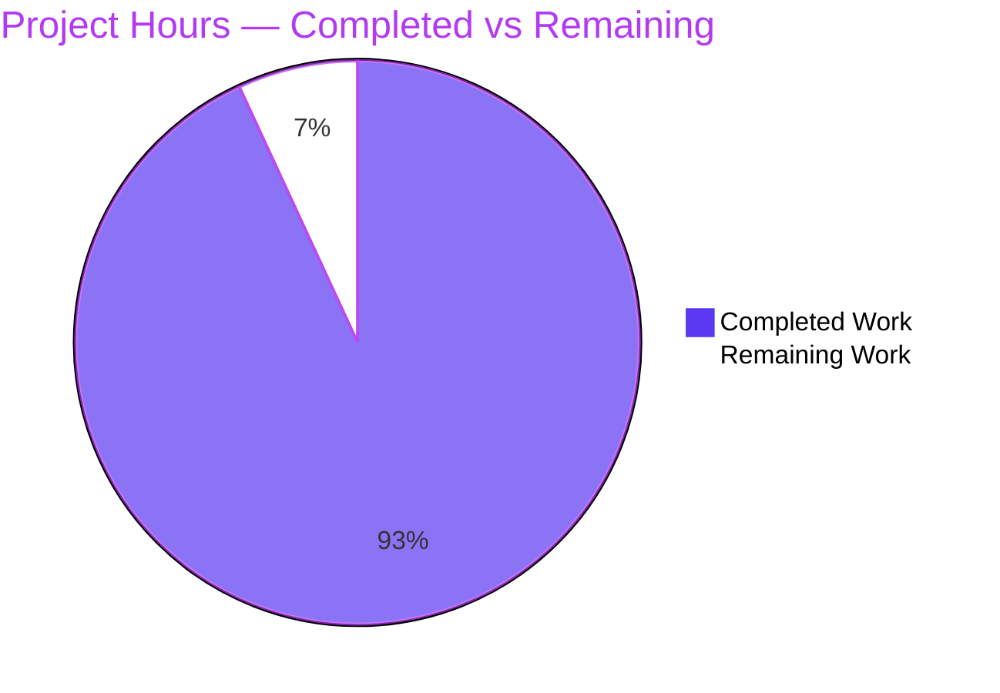
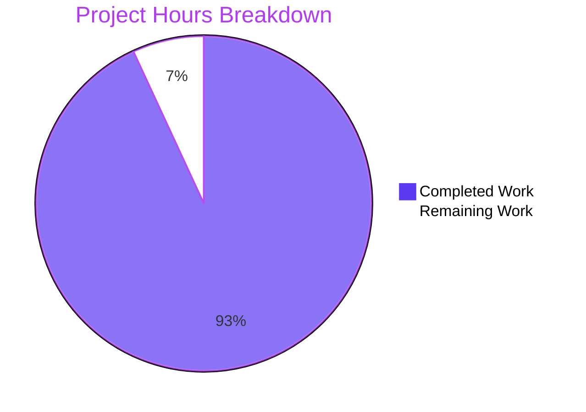
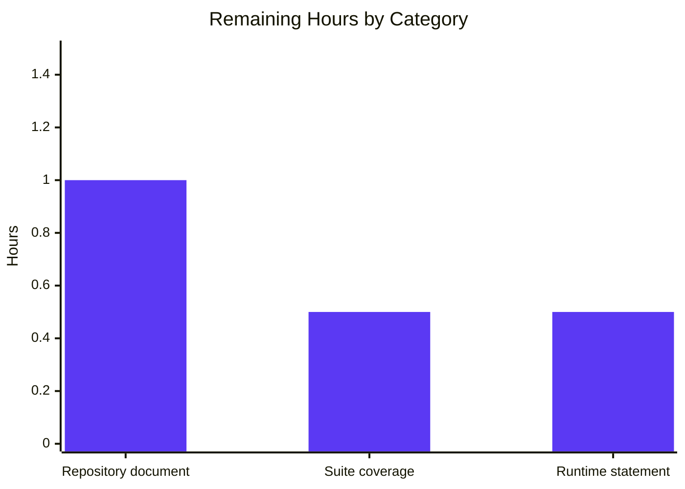

# 1. Executive Summary

## 1.1 Project Overview

A Node.js tutorial around a single HTTP endpoint. `src/app.js` answers `GET` and `HEAD /hello` with the literal `Hello world` as `text/plain; charset=utf-8`, answers every other path and method with `404`, and carries no framework, dependency, database or build step. `src/server.js` binds the operator's address and prints one line naming it; `README.md` walks a reader from prerequisites to a verified response and a clean stop. Its readers are developers learning `node:http`; its value is a reproducible example they can extend in one branch.

## 1.2 Completion Status

**Result: 27.0 hours completed out of 29.0 total hours = 93% complete.** Hours cover the plan's eight deliverables, the endpoint contract, the suite, the tutorial and the verification that proves them.



| Metric | Hours | Basis |
|---|---|---|
| Total Hours | 29.0 | Plan-scoped deliverables plus the path-to-production work they imply |
| Completed Hours (Baseline: Human with agentic-assist) | 27.0 | 49 of 50 requirements fully met and verified on the running server |
| Remaining Hours | 2.0 | One requirement met in part, one coverage decision and one documentation statement not yet confirmed on the releases it names |

## 1.3 Key Accomplishments

- `GET` and `HEAD /hello` return `200` with the exact 11-byte `Hello world` as `text/plain; charset=utf-8`; `HEAD` carries neither a body nor a length.
- Every other path and method — `CONNECT` included — receives `404` with the 9-byte `Not Found` body.
- Routing reads the pathname only: queries are ignored, no client-supplied host can choose the route, and an unparsable target still gets the 404.
- Fixed-length framing holds over HTTP/1.1 and HTTP/1.0; `HOST`/`PORT` reach the bind with `127.0.0.1`/`3000` defaults, and an empty `HOST` still lands on loopback.
- Five contract cases pass on one command against a real socket, and the tutorial's every quoted output matches the shipped code.

## 1.4 Critical Unresolved Issues

Seven items are open against the fifty requirements this work is held to.

| Issue | Impact | Owner | ETA |
|---|---|---|---|
| Deliverable tree — 1 item: the tracked tree holds nine paths against the plan's eight, the extra being a 461-line project-status document that repeats an old-runtime diagnostic and a line-count sentence the tutorial no longer contains | Two documents in the repository describe the same files differently, and the plan fixes the tree at eight paths | Repository owner | 1.0 h |
| Behaviours no test asserts — 5 items: HTTP/1.0 framing, the `CONNECT` 404, unparsable targets, the empty-`HOST` loopback fallback, absolute-form routing | A future edit could break any of them while `npm test` stays green | Engineering owner | 0.5 h |
| Runtime-match statement — 1 item: the tutorial's sentence that Node.js 18 and 20 run this code rests on release documentation; the suite has not been run on 18.20 or 20.x | A reader on either release is told something no run of this suite has confirmed | Documentation owner | 0.5 h |

## 1.5 Access Issues

No access issues identified: no credential, registry access or external service is needed, the install resolves offline, and the project opens only its loopback listener.

## 1.6 Recommended Next Steps

1. **[High]** Settle coverage for the five behaviours only probes prove: add assertions if the five-case contract is revisited, or check them by hand on changes to `src/app.js` (0.5 h).
2. **[Medium]** Regenerate the repository's second status document from the corrected tutorial, or remove it so the tree holds the eight planned paths (1.0 h).
3. **[Low]** Run `npm test` on Node.js 18.20 and 20.x to confirm the tutorial's sentence about those releases (0.5 h).
4. **[Low]** Keep `npm test` as the merge gate; add a pipeline only if the project outlives its tutorial scope.

# 2. Project Hours Breakdown

## 2.1 Completed Work Detail

| Component | Hours | Description |
|---|---|---|
| Foundation — manifest, lockfile, runtime pin, ignore rules | 2.0 | Six-key `package.json` with both scripts and no dependency field, npm-generated `package-lock.json` at lockfileVersion 3 with the root entry only, `.nvmrc` pinned to `22`, four `.gitignore` entries; `npm install` and `npm ci` both resolve nothing and exit 0 |
| Request handler and server factory (`src/app.js`) | 5.0 | Route constants, guarded fixed-base target parse, single method-and-pathname decision, fixed-length response write with the `HEAD` exemption, contract 404 for the method `node:http` routes outside the request listener, and the rationale comments |
| Process entry point and configuration (`src/server.js`) | 3.0 | `HOST`/`PORT` reads with a falsy loopback default and a numeric port default, `listen`, one startup line built from `server.address()` with IPv6 bracketing, and no server-level `'error'` listener so bind failures surface |
| Contract test suite (`test/hello.test.js`) | 3.0 | Five cases with the specified names and 17 assertions over a real socket, port-0 setup and teardown, and a teardown guard that keeps a fully filtered run a clean no-op |
| Tutorial walkthrough (`README.md`) | 5.0 | 221 lines: what the project is, prerequisites, install, tests, start, call, correct response, stop, port change, extend, troubleshooting — every step quoting output re-derived from the delivered code, with the quoted client blocks reproducible from a real capture and the source size stated as measured |
| Runtime contract verification | 5.0 | HTTP/1.1 and HTTP/1.0 framing, the path and method matrix, `CONNECT`, malformed and unparsable targets, query handling, host independence, configuration overrides, bind diagnostics and the default and overridden port, all exercised on a running instance |
| Security posture verification | 2.0 | Loopback-only exposure, inert handling of bodies and traversal payloads, response header hygiene, and secret and internal-detail scans across the delivered files |
| Readability and rationale comments | 2.0 | Comment blocks that state reasoning the code cannot show, the style conventions, and the measured 78 lines the tutorial reports for the handler plus entry point |
| **Total** | **27.0** | Equals the Completed Hours in Section 1.2 |

## 2.2 Remaining Work Detail

| Category | Hours | Priority |
|---|---|---|
| Settle suite coverage for the five probe-only behaviours — add assertions if the five-case contract is revisited, or record the five-case suite as the settled contract and check them by hand on changes to `src/app.js` | 0.5 | High |
| Reconcile the repository's extra tracked status document with the corrected tutorial, or remove it so the tree holds the eight planned paths | 1.0 | Medium |
| Confirm the tutorial's Node.js 18/20 sentence by running the suite on 18.20 and on 20.x | 0.5 | Low |
| **Total** | **2.0** | Equals the Remaining Hours in Section 1.2 and the "Remaining Work" value in Section 7 |

## 2.3 Calculation and Estimate Confidence

**Formula with actual numbers:** `Completed Hours / (Completed Hours + Remaining Hours) × 100` = `27.0 / (27.0 + 2.0) × 100` = `27.0 / 29.0 × 100` = `93.10%`, reported as **93%** in Sections 1.2, 7 and 8.

**Confidence.** High for the eight completed components: each was read line by line and its behaviour reproduced on a running instance, so their hours rest on work that is visibly present. Medium for the verification components, whose hours reflect effort rather than artifact volume. High for the remaining estimate in aggregate and lower per item, because the largest remaining item is a repository-hygiene decision rather than new functionality. Nothing in the remaining work changes runtime behaviour: 27.0 h of the 29.0 h total is delivered and observable, and the 2.0 h outstanding is one coverage decision, one document reconciliation and one statement to confirm on two other Node releases.

# 3. Test Results

Every row below is a test or probe that was executed on this branch and whose result was observed. No coverage tool is configured and the project's scope excludes adding one, so no coverage percentage exists to report.

| Area / Category | Framework | Tests | Passed | Failed | Coverage | What This Proves |
|---|---|---|---|---|---|---|
| Endpoint contract suite | `node:test` (`npm test` → `node --test`) | 5 cases, 17 assertions | 5 | 0 | No coverage tool configured | The five contract behaviours are asserted over a real socket: greeting bytes, media type, declared length, absence of chunking, query tolerance, `HEAD` framing, trailing-slash 404 and method 404 |
| Suite lifecycle and discovery | `node:test` (full run twice, one file, a name pattern selecting three cases, a pattern selecting none) | 5 invocations | 5 | 0 | Not applicable | The suite runs green, is not a vacuous zero-test pass, and a run that selects no case exits 0 without hanging |
| Path and method matrix | `curl` | 11 probes | 11 | 0 | Not applicable | Ten other paths and methods, `CONNECT` included, receive `404` with the 9-byte `Not Found` body, while the query string keeps the 200 greeting |
| Framing across protocol versions | `curl --http1.1` / `--http1.0` | 3 captures | 3 | 0 | Not applicable | `Content-Length` 11 is declared on both protocol versions, `HEAD` carries neither length nor body, and no response is chunked |
| Host-independent routing and malformed targets | `curl` | 3 probes | 3 | 0 | Not applicable | An absolute-form target carrying a hostile host still matches `/hello`, and two targets the URL parser rejects are answered with the contract 404 while the process keeps serving |
| Configuration, lifecycle and bind diagnostics | `node` and `curl` | 6 probes | 6 | 0 | Not applicable | An OS-assigned port is reported and served, the `PORT=4500` override binds and answers without a source edit, an empty `HOST` stays on loopback, a taken port exits 1 with the runtime's own diagnostic, and the port is released on stop |
| Static and install gates | `node --check`, `npm install`, `npm ci` | 3 checks | 3 | 0 | Not applicable | All three JavaScript files parse, and both install commands resolve nothing, create no `node_modules` and leave the lockfile byte-identical |

## Not Covered

The following are delivered and working but are not exercised by any test in the repository. Each is proven only by the probes recorded above, so a future edit could regress it without `npm test` failing:

- **HTTP/1.0 fixed-length framing** — the declared `Content-Length` on an HTTP/1.0 response is proven by `curl --http1.0` only; the suite is fixed at five HTTP/1.1 cases.
- **The `CONNECT` 404** — answered by `handleConnect` in `src/app.js:40-54` and verified over a socket, but not asserted anywhere.
- **Unparsable request targets** — the guard at `src/app.js:11-19` is verified with `//[` and `http://%zz/hello`, neither of which the suite sends.
- **The empty-`HOST` loopback fallback** — verified by starting with `HOST=` and observing `Listening on http://127.0.0.1:…`; no assertion covers it, and the startup line's text is deliberately not asserted at all (AAP 0.8).
- **Host-independent routing on absolute-form targets** — verified by probe; the suite's query-string case does not exercise it.
- **`HEAD` discrimination is partial by construction** — the suite's `HEAD` assertions cannot distinguish the correct handler from the rejected framing form, because the runtime suppresses every `HEAD` body and the rejected form also omits `Content-Length` on `HEAD`. The discriminating assertions are the `GET` case's `content-length` and `transfer-encoding`.
- **Invalid configuration values** — `PORT` that is not a number in range and an unresolvable `HOST` end the process with the runtime's own diagnostic; the behaviour is documented and unasserted.
- **Node.js 18.20 and 20.x** — the tutorial says those releases run this code, and no run of this suite has been made on either; the statements about releases older than the test runner are settled by execution.
- **No performance, load or concurrency assertion exists** — the first response after a launch was measured at tens of milliseconds, which is an observation, not a test.
- **No browser, UI or accessibility surface exists to test** — the product's only output is a plain-text HTTP body.

**Before release, a human should exercise:** the five behaviours proven only by probes, an invalid `PORT` and an unresolvable `HOST`, and `npm test` on Node.js 18.20 and 20.x.

# 4. Runtime Validation & UI Verification

The project exposes no user interface, no browser client and no rendering surface: its entire observable output is a plain-text HTTP body, and its interface is the terminal. Runtime validation therefore drove the server over HTTP and over a raw socket.

- ✅ **Start-up** — `PORT=0 node src/server.js` printed exactly one line, `Listening on http://127.0.0.1:35441`, then held the process with an empty error stream and no further output while serving.
- ✅ **`GET /hello`** — `200`, `Content-Type: text/plain; charset=utf-8`, `Content-Length: 11`, body `Hello world`; `curl -s … | wc -c` returned `11`.
- ✅ **`HEAD /hello`** — `200`, the same media type, no body and no `Content-Length`.
- ✅ **Other paths and other methods** — `/`, `/nope`, `/hello/` and `POST`/`PUT`/`DELETE`/`OPTIONS`/`PATCH`/`TRACE` on `/hello` each returned `404` with the 9-byte `Not Found` body.
- ✅ **`CONNECT`** — answered with the same `404` and a 9-byte body, from the handler that owns the tunnel socket rather than the request listener.
- ✅ **Query strings and host independence** — `/hello?name=world` returned the same 11 bytes, and an absolute-form target carrying `Host: evil.example` was routed by pathname alone.
- ✅ **HTTP/1.0 clients** — the 200 carried its declared `Content-Length: 11` with `Connection: close`, framed for a closing connection and never chunked.
- ✅ **Malformed request targets** — `//[` and `http://%zz/hello` each answered the contract 404, and the process kept serving afterwards.
- ✅ **Configuration and bind failures** — `PORT=4500` took effect with no source edit, `HOST=` still bound `127.0.0.1`, the documented default `3000` bound and was released, and a second instance on a bound port exited 1 with the runtime's own `EADDRINUSE`. An independent client (a headless browser) rendered `Hello world` at `/hello` and the server's own `Not Found` at `/nope` with no console errors.
- ✅ **Suite and stop** — `npm test` reported 5 of 5, a single-file run 5 of 5, a name pattern 3 of 3 and a pattern matching nothing exited 0; stopping the server released the port (a connect attempt was refused afterwards).

**Never exercised at runtime:** `npm test` on Node.js 18.20 or 20.x, and the reporter behaviour the tutorial attributes to Node.js 23 and later, which rests on release documentation rather than on a run; throughput, load and concurrency measurement, which no assertion covers; and any rendered surface, because none exists. Note also that `npm start` runs the server as a child of npm, so signalling only the npm process leaves the server holding the port — `Ctrl-C` reaches the whole foreground process group, which is why the documented stop works.

# 5. Compliance & Quality Review

## 5.1 Compliance Matrix

| Deliverable | Requirement It Is Held To | Status | Progress | Evidence |
|---|---|---|---|---|
| Availability and lifecycle | Listens on the operator's host and port and stays up while the process runs | Pass | ██████████ 100% | `src/server.js:9-18`; sustained request runs and a clean signal-driven stop |
| Greeting and `HEAD` contract | `GET` and `HEAD /hello` → 200, `text/plain; charset=utf-8`, 11-byte body, no body or length on `HEAD` | Pass | ██████████ 100% | `src/app.js:20,28-32`; live probes; suite cases 1 and 3 |
| Catch-all 404 | Every other path and every other method → 404 `Not Found` (9 bytes) | Pass | ██████████ 100% | `src/app.js:28-32,40-58`; ten path and method probes including `CONNECT` |
| Routing model | Pathname only; query ignored; no client-supplied host can choose the route | Pass | ██████████ 100% | `src/app.js:11-20`; query, `Host`-spoof and absolute-form probes |
| Configuration and diagnostics | `HOST`/`PORT` with `127.0.0.1`/`3000` defaults, overridable without a source edit; bind failures surfaced | Pass | ██████████ 100% | `src/server.js:4-7,11-18`; override, empty-`HOST`, default-port and `EADDRINUSE` probes |
| Tutorial walkthrough | Prerequisites to a verified response and a clean stop, each step quoting its output | Pass | ██████████ 100% | `README.md` — eleven sections in the required order, every step reproduced, both quoted client blocks matching a live capture |
| Contract suite | One suite, one command, exactly the specified assertions | Pass | ██████████ 100% | `test/hello.test.js` — 5 cases, 17 assertions; `npm test` 5 of 5, exit 0 |
| Runtime line and footprint | Node.js 22 line declared three ways; no package dependency | Pass | ██████████ 100% | `package.json` `>=22.0.0`, `.nvmrc` `22`, README prerequisites; offline install resolves nothing |
| Startup speed and determinism | Reader sees a prompt immediately; identical response bytes on every machine | Pass | ██████████ 100% | Tens of milliseconds to first response; `Content-Length` 11/9 on HTTP/1.1 and HTTP/1.0, never chunked |
| Source readability | Readable in one sitting, reasoning commented, size stated as measured | Pass | ██████████ 100% | Comments at `src/app.js:8-10,15-18,22-27,35-39,41-44` and `src/server.js:4-5,12-13,15`; `README.md:195` states 78 lines (60 + 18) with a 67-line suite |
| Security posture | Loopback default, no body parsing, no filesystem access, no evaluation, host-independent routing | Pass | ██████████ 100% | `src/server.js:6`; `src/app.js:11-20`; loopback-only bind observed, payload sweeps answered from fixed literals, no `Server` header |
| Deliverable set and exclusions | Exactly the eight named files; no framework, persistence, build, container, CI or UI | Partial | █████████░ 90% | The eight planned files are present and every excluded capability is absent, but the tracked tree also carries one project-status document outside the plan's file set — nine paths where the plan fixes eight |

## 5.2 AAP & Rule Divergences and Gaps

No user-specified rules were provided for this project, so no rule departure is possible and none was invented. The seven departures below are from the plan's own text: five are governed by a more specific requirement in the same plan or by the accuracy standard the tutorial is held to, one is a deliberate design decision, and one remains open.

| What the AAP/Rule Required | What Was Delivered Instead | Why It Diverged | Impact | Remediation |
|---|---|---|---|---|
| "The handler and the entry point together are roughly 40 lines including comments … with a test file of comparable size" (0.11), and "roughly 40 lines of application code" (NFR-4) | 78 lines including comments and blank lines — `src/app.js` 60 and `src/server.js` 18 — with a 67-line suite, and the tutorial states those measured figures at `README.md:195` | Answering every other method with the 404 needs a listener of its own, and the plan also requires the non-obvious reasoning to be commented, which costs lines; the tutorial's accuracy standard requires every count to be true of the tree as delivered, and the source is not shortened to reach a figure | Sanctioned. The source has no abstraction and reads in one sitting, and the tutorial reports what the files actually measure | None. The measured figure is the correct one and the source is not shortened |
| The quoted `GET /hello` and 404 blocks list `Date`, `Connection` and `Keep-Alive` before `Content-Length` (0.8) | The tutorial quotes the order a client receives — `Content-Type`, `Content-Length`, `Date`, `Connection`, `Keep-Alive` — and lines 109 and 138 state that the order of the runtime-generated headers is not part of the contract | A capture on this runtime prints that order, and the tutorial's accuracy standard requires every quoted output to match what the reader's terminal shows | Sanctioned. No value changed: 200 and 404, the media type, lengths 11 and 9, and both bodies are exactly as 0.8 fixes them | None |
| The step-1 diagnosis quotes `Cannot find module 'node:test'` for releases below the supported line (0.11) | `README.md:25` and the first troubleshooting row state `node: bad option: --test` with exit code 9 where there is no test runner, and `fetch is not defined` where there is a runner but no global `fetch` | No release prints the quoted message on that path: a release without the runner stops at option parsing, and a missing `node:` built-in raises `ERR_UNKNOWN_BUILTIN_MODULE`. The tutorial's accuracy standard outranks the plan's wording | Sanctioned. A reader on an older release now meets the failure they will actually see | None |
| "The project sets no other header" beyond `Content-Type` (0.7.2) | The handler also declares `Content-Length` on every body-bearing response (`src/app.js:31`) | A fixed length with no chunked body is required by NFR-5, the calling client must not have to guess the length, and the header-for-header contract in 0.8 fixes `Content-Length: 11`/`9`; the runtime emits no length for HTTP/1.0 | Governed by the more specific requirements. An HTTP/1.0 client now receives a declared length | None |
| Configuration defaults follow the `??` idiom (0.5, 0.15.1) | `HOST` uses a falsy fallback, `process.env.HOST \|\| '127.0.0.1'` (`src/server.js:6`), with the reason commented above it | `??` passes an explicitly empty `HOST` through, and the runtime then binds every interface instead of loopback, which the loopback-default requirement forbids | Deliberate. An empty `HOST` stays on loopback; `PORT` keeps `??` and is unchanged | None — keep the falsy default for `HOST` |
| "No `'error'` listener is added to the server" (0.15.1), with `http.createServer(handleRequest)` as the factory (0.9.2) | `createServer()` also registers a `'connect'` listener (`src/app.js:58`), and that listener attaches a per-connection socket `'error'` handler (`:45`) | The universal 404 needs the `'connect'` event, which the request listener never sees; without the socket handler a client that resets during that answer ends the process, which the availability requirement forbids | Governed by the 404 and availability requirements. No server-level listener exists, so bind failures still exit 1 with the runtime's own message | None now; preserve the server-level versus connection-level distinction on any future change to the factory |
| The tree holds exactly the eight named files, and "no deliverable exists outside this table" (0.9.1, 0.12.1) | Nine tracked paths: the eight deliverables plus a 461-line project-status document under `blitzy/documentation/`, which still states an old-runtime diagnostic the tutorial has dropped and calls `README.md:193-195` "about forty lines"; four untracked screenshots also sit under `blitzy/screenshots/` | The document was written before the tutorial's accuracy pass, and that pass was confined to `README.md`, so no change to it was made | Open. The repository ships two documents that disagree about the same files, and a reader can be sent to a sentence the tutorial no longer contains | Remove the extra document, or regenerate it from the corrected tutorial (1.0 h) |

**The tracked status document (departure 7).** The repository contains a second, 461-line account of this project under `blitzy/documentation/`. It was written before the tutorial was corrected and has not moved with it: it still tells a reader that an old runtime fails with `Cannot find module 'node:test'`, and that `README.md:193-195` calls the source "about forty lines" — a sentence the tutorial no longer contains. It also sits outside the eight paths the plan fixes as the deliverable. Nothing in it endangers the endpoint, and the untracked screenshots beside it are simply evidence images, but the repository now holds two answers to the same questions. A repository owner should either regenerate the document from the corrected tutorial or remove it; the work is documentation-only and changes no behaviour.

**The measured line figure (departure 1).** The plan fixes a size expectation for the application code and the tutorial used to repeat it as "about forty lines". `src/app.js` and `src/server.js` together are 78 physical lines including comments and blank lines, and the test file is 67, because answering every other method with the 404 needs a listener of its own and the framing decision needs its own rationale. The intent behind the requirement still holds: there is no router, no abstraction and no configuration module to hold in mind alongside `node:http`. What changed is the number, and `README.md:195` now states the measured 78 / 60 / 18 / 67, so a reader who counts `wc -l` sees the same figures. The source is not shortened to reach forty lines.

**The old-runtime diagnostic (departure 3).** The plan's step-1 text quotes `Cannot find module 'node:test'`, and the tutorial used to repeat it in two places. That message does not appear on that path: a release without the test runner stops in option parsing with `node: bad option: --test` and exit code 9, and a release that has the runner but no global `fetch` fails with `fetch is not defined`. Both facts were established by running the project's own test command on releases older than the supported line, and `README.md:25` and the troubleshooting table now state them together, with the accurate parts of the guidance — Node 18 and 20 are end of life, install the 22 LTS line, run `nvm use` — untouched.

**The `'connect'` listener and the per-connection error handler (departure 6).** `createServer()` returns `http.createServer(handleRequest)` with one additional registration, and `handleConnect` writes the same 404 the request handler writes, straight to the tunnel socket, because that event supplies no response object to set a status code on. The socket-level error handler at `src/app.js:45` is load-bearing: without it a client that sends `CONNECT` and then resets the connection raises an unhandled error and ends the process. The plan's prohibition is aimed at a *server-level* `'error'` listener, because that would swallow the bind diagnostic the troubleshooting table points a reader at; no such listener exists, and a second instance on a bound port still exits 1 with the runtime's own `EADDRINUSE`. A reviewer should confirm that distinction holds the next time this factory changes.

# 6. Risk Assessment

Risks are forward-looking: what could still go wrong once this code is in use. No integration risk exists — the project talks to no external service, database, queue, cache, identity provider or registry, and its install fetches nothing.

| Risk | Category | Severity | Probability | Mitigation | Status |
|---|---|---|---|---|---|
| A behaviour that only probes assert — HTTP/1.0 framing, the `CONNECT` 404, unparsable targets, the empty-`HOST` loopback fallback, absolute-form routing — regresses silently while `npm test` stays green | Technical | Medium | Medium | Add assertions if the five-case contract is revisited, or check those five behaviours by hand in every change that touches `src/app.js` | Open |
| The repository's second status document keeps contradicting the tutorial, sending a reader to wording the tutorial no longer contains | Technical | Low | High | Remove it, or regenerate it from the corrected tutorial | Open |
| An operator sets `HOST` to a non-loopback address and publishes an unauthenticated, unrate-limited, unencrypted greeting with no hardening headers | Security | Medium | Low | The shipped default is loopback only; add a caution wherever the override is explained | Accepted posture |
| Slow or half-open clients hold one descriptor each until the runtime's header timeout (60 s by default), a cheap exhaustion path if the bind is ever widened | Security | Low | Low | The loopback bind keeps it local; revisit limits before publishing the service anywhere | Accepted posture |
| Nothing runs the suite automatically: a change reaches the branch with only a manual `npm test` between it and the tree | Operational | Medium | Medium | Run `npm test` before every merge; add a pipeline if the project outlives its tutorial scope | Open |
| The runtime floor is advisory — `engines.node` is not enforced (`engine-strict` is `false`, no `.npmrc`) — so a reader on an older release meets `node: bad option: --test` at test time rather than a refusal at install time | Operational | Low | Medium | Declared three ways (manifest, `.nvmrc`, prerequisites) and named in the prerequisites and troubleshooting sections | Open |
| Requests the HTTP parser rejects or short-circuits (malformed request lines, oversized headers) are answered by the runtime with its own status before the handler runs, so the documented two-outcome contract does not describe every possible response | Technical | Low | Low | The contract is scoped to what the handler writes; say so where the contract is stated if the audience widens | Accepted |
| There is no observability beyond the single startup line — no health, readiness, metrics or structured logs — so an operator cannot tell an idle process from a wedged one without probing the endpoint | Operational | Low | Low | Probe `GET /hello`; add a health signal only if this stops being a tutorial | Accepted posture |

# 7. Visual Project Status

**Hours: 27.0 completed, 2.0 remaining, 29.0 total — 93% complete.**



**Remaining hours by category**, matching Section 2.2:



| Category | Remaining Hours | Priority |
|---|---|---|
| Reconcile or remove the repository's extra tracked status document | 1.0 | Medium |
| Suite coverage decision for the five probe-only behaviours | 0.5 | High |
| Node.js 18/20 statement confirmed by running the suite on those releases | 0.5 | Low |
| **Total** | **2.0** | — |

**Status at a glance.** Every deliverable the plan scoped exists, the endpoint contract was exercised over HTTP/1.1, HTTP/1.0 and a raw socket, the suite passes 5 of 5 on one command with 17 assertions, the tutorial's every quoted output matches the shipped code, and 49 of the 50 tracked requirements are fully met. What remains is one requirement met in part, one coverage decision and one statement to confirm on two other Node releases — 2.0 hours, with no unimplemented feature, no failing test and no release blocker in the endpoint itself.

# 8. Summary & Recommendations

**What was delivered and verified.** The project ships the eight files it was scoped to: a dependency-free Node.js HTTP server whose single endpoint answers `GET` and `HEAD /hello` with the literal 11-byte `Hello world` as `text/plain; charset=utf-8`, answers every other path and every other method — `CONNECT` included — with a 9-byte `404 Not Found`, and a 221-line tutorial that walks a reader from prerequisites to a verified response and a clean stop. The contract was exercised on a running instance over HTTP/1.1, HTTP/1.0 and a raw socket; the five-case suite passes on one command with 17 assertions; the install resolves nothing; and every quoted output in the tutorial matches a live capture. 49 of the 50 tracked requirements are fully met, for **93% complete (27.0 of 29.0 hours)**.

**What remains.** Two hours across three items, none of which changes the endpoint's behaviour: deciding whether the five behaviours proven only by probes receive assertions or whether the five-case suite is the settled contract; reconciling or removing the repository's second, 461-line status document, which still repeats an old-runtime diagnostic and a line-count sentence the tutorial no longer contains; and running `npm test` on Node.js 18.20 and 20.x to confirm the tutorial's sentence about those releases. There is no unimplemented endpoint, no failing test and no unresolved defect in the delivered code.

**Production readiness.** As a production service this codebase would be incomplete by design: no authentication, TLS, rate limiting, persistence, health or metrics endpoint, container or pipeline, all deliberate exclusions of a loopback tutorial. As the tutorial it set out to be, it is ready: a reader who follows `README.md` alone reaches the verified response and stops the server cleanly, the quoted outputs reproduce, the source size the document states is the one `wc -l` reports, and every failure a reader is likely to hit — a taken port, nothing listening, a trailing slash, a body with a stray newline, a runtime too old for the test runner — is diagnosed in the tutorial with the message that release actually prints.

**Success metrics observed.** `GET /hello` returns `Content-Length: 11` with the exact greeting and no chunked body on both protocol versions; `HEAD` returns the same media type with no body and no length; ten path and method probes return the 9-byte 404 while the query-string call returns the same greeting; two unparsable request targets are answered without ending the process; a spoofed `Host` inside an absolute-form target cannot choose the route; `npm test` reports `# tests 5 / # pass 5 / # fail 0` with exit 0 and also runs green as a single-file and a name-pattern selection; `npm install` and `npm ci` resolve nothing and leave the lockfile byte-identical; and the process reports the address it bound on exactly one line.

**Recommendation.** Merge it, then close the three remaining items in the order given in Section 1.6, giving priority to the suite-coverage decision, because that is the one item that protects behaviour a future change could break without any test noticing. Everything else the plan asked for is present, exercised and documented.

# 9. Development Guide

## System Prerequisites

- **Node.js 22 or later** on the `PATH` — the project pins the 22 line in `.nvmrc` and declares `engines.node: ">=22.0.0"`. Verified on v22.23.5 with npm 11.21.3.
- **No other tool**: no database, broker, container, credential or build toolchain. `curl` is convenient for the verification steps but the suite uses Node's own `fetch`.

```bash
node --version      # expect v22.x or later, e.g. v22.23.5
npm --version       # e.g. 11.21.3
cat .nvmrc          # 22 — run `nvm use` first if you use a version manager
```

## Environment Setup and Installation

The repository declares **no dependencies**, so installation only validates the manifest and lockfile. Run everything from the repository root.

```bash
# from the repository root
npm install
```

Expected output — the millisecond figure varies, the two lines and the zero vulnerabilities do not:

```text
up to date, audited 1 package in 142ms

found 0 vulnerabilities
```

No `node_modules` directory is created and `package-lock.json` stays byte-identical; `npm ci` prints the same two lines and leaves the tree unchanged. No `.env` file is needed or read.

## Run the Tests

```bash
npm test
```

Expected tail of the output, with exit code `0` (the duration varies):

```text
1..5
# tests 5
# suites 0
# pass 5
# fail 0
# cancelled 0
# skipped 0
# todo 0
# duration_ms 135.568534
```

The run opens with `TAP version 13` and prints an `ok N - <case>` line per case. In an interactive terminal the same counts appear in Node's spec reporter (`✔` per case, then `ℹ tests 5`), so compare the counts and the exit code, not the punctuation.

Narrower runs, all verified:

```bash
node --test test/hello.test.js                                    # 5 of 5, the per-change gate
node --test --test-name-pattern='GET /hello' test/hello.test.js    # the three matching cases, exit 0
node --test --test-name-pattern='NoSuchCase' test/hello.test.js    # selects nothing, exits 0 without hanging
```

## Start the Server

```bash
npm start                 # binds 127.0.0.1:3000
PORT=4500 npm start       # or bind another port
```

Expected output — npm's own two echo lines and a blank line, then exactly one line from the application, after which the process holds the terminal:

```console
> nodejs-hello-tutorial@1.0.0 start
> node src/server.js

Listening on http://127.0.0.1:3000
```

Nothing else is printed, including while the server answers requests. If port 3000 is busy on your machine, use the `PORT=` form; the suite never collides because its own server binds an OS-assigned port.

## Verify the Endpoint

Leave the server running and use a second terminal.

```bash
curl -isS http://127.0.0.1:3000/hello
```

```text
HTTP/1.1 200 OK
Content-Type: text/plain; charset=utf-8
Content-Length: 11
Date: <generated per request>
Connection: keep-alive
Keep-Alive: timeout=5

Hello world
```

The remaining checks, each verified on this branch:

```bash
curl -s http://127.0.0.1:3000/hello | wc -c                  # 11
curl -isS --head http://127.0.0.1:3000/hello                 # 200, same media type, no body, no Content-Length
curl -isS 'http://127.0.0.1:3000/hello?name=world'           # the same 200 response
curl -isS http://127.0.0.1:3000/nope                         # 404, Content-Length: 9, body Not Found
curl -isS http://127.0.0.1:3000/hello/                       # 404 — a different pathname
curl -sS -X POST -o /dev/null -w '%{http_code}\n' http://127.0.0.1:3000/hello   # 404 — a different method
curl -sS --http1.0 -D- -o /dev/null http://127.0.0.1:3000/hello                 # 200, Content-Length: 11, Connection: close
```

## Stop the Server

Press `Ctrl-C` in the terminal running `npm start`. `npm` runs the server as a child process, so the signal has to reach the whole foreground process group — which `Ctrl-C` does — and then both exit and the port is released. A scripted stop must signal the node process or the group: stopping only the `npm` process leaves the server holding the port.

## Example Usage: Add a Route

Two edits inside the files that already exist, and no new module, router or dependency:

1. In `src/app.js`, add a branch beside the existing decision in `handleRequest`, using the same `statusCode` + `setHeader` + `end` shape so the response stays fixed-length.
2. In `test/hello.test.js`, add a case beside the existing ones asserting the new path's status and body, then run `npm test`.

## Environment Variables

Two settings, both read in `src/server.js`, both overridable per run with no source edit and no `.env` file:

- `HOST` — the bind address, `127.0.0.1` by default. An empty value still falls back to `127.0.0.1`, and an IPv6 address is printed bracketed (`http://[::1]:3000`).
- `PORT` — the bind port, `3000` by default. `PORT=0` binds an OS-assigned port, which the startup line reports.

The full reference, with the exact line each variable is read at, is in Appendix E.

## Troubleshooting

| Symptom | Cause | Resolution |
|---|---|---|
| `Error: listen EADDRINUSE: address already in use 127.0.0.1:3000` on start | The port is already held, often by an earlier instance | Stop the other instance, or start with `PORT=4500 npm start` |
| `curl: (7) Failed to connect … Could not connect to server` | Nothing is listening on that host and port | Start the server, and check the port against the `Listening on …` line |
| `404` where `/hello` was expected | The path is not exactly `/hello` (trailing slash, other segment) or the method is not `GET`/`HEAD` | Use `GET`/`HEAD` on `/hello`; the query string is fine, a trailing slash is not |
| `curl -s …/hello \| wc -c` prints `12` | A trailing newline was added to the greeting | The body must be exactly `Hello world`, with no newline |
| Test failures on `Content-Length`, with `Transfer-Encoding: chunked` on the wire | The response was written with the rejected head-writing form instead of `statusCode` + `setHeader` + `end` | Restore the fixed-length write, and keep `HEAD` free of `Content-Length` |
| `node: bad option: --test`, exit code `9`, or `fetch is not defined` in every case | The Node release is too old: one without the test runner stops at option parsing, one with the runner but no global `fetch` fails in every case | Install Node 22 or later; `nvm use` reads `.nvmrc` |
| `RangeError [ERR_SOCKET_BAD_PORT]` | `PORT` is not a number in range | Use a numeric port below 65536 |
| `getaddrinfo ENOTFOUND` or `EADDRNOTAVAIL` | `HOST` names something that does not resolve or is not a local address | Use an IP literal, normally `127.0.0.1` |
| The port is still held after stopping a scripted `npm start` | Only the `npm` parent was signalled; the server is its child | Signal the node process or the process group, or use `Ctrl-C` in the terminal |

## Command Reference for This Project

| Task | Command |
|---|---|
| Install / validate | `npm install` or `npm ci` (offline-capable; creates no `node_modules`) |
| Run the suite | `npm test` (`node --test` from the repository root) |
| Run one file | `node --test test/hello.test.js` |
| Run a named subset | `node --test --test-name-pattern='GET /hello' test/hello.test.js` |
| Syntax-check the sources | `node --check src/app.js && node --check src/server.js && node --check test/hello.test.js` |
| Start on the default port | `npm start` |
| Start on another port | `PORT=4500 npm start` |
| Stop | `Ctrl-C` in the terminal running the server |

# 10. Appendices

## A. Command Reference

One-line checks, each executed on this branch:

| Purpose | Command | Expected |
|---|---|---|
| Greeting, headers and body | `curl -isS http://127.0.0.1:<port>/hello` | `200`, `text/plain; charset=utf-8`, `Content-Length: 11`, body `Hello world` |
| Exact body length | `curl -s http://127.0.0.1:<port>/hello \| wc -c` | `11` |
| Bodiless `HEAD` | `curl -isS --head http://127.0.0.1:<port>/hello` | `200`, media type present, no `Content-Length`, no body |
| Query tolerance | `curl -isS 'http://127.0.0.1:<port>/hello?name=world'` | the same `200` response |
| Unknown path | `curl -isS http://127.0.0.1:<port>/nope` | `404`, `Content-Length: 9`, `Not Found` |
| Unknown method | `curl -sS -X POST -o /dev/null -w '%{http_code}\n' http://127.0.0.1:<port>/hello` | `404` |
| `CONNECT` method | `curl -sS -X CONNECT -o /dev/null -w '%{http_code} %{size_download}\n' http://127.0.0.1:<port>/hello` | `404 9` |
| HTTP/1.0 framing | `curl -sS --http1.0 -D- -o /dev/null http://127.0.0.1:<port>/hello` | `200`, `Content-Length: 11`, `Connection: close` |
| Port in use | a second `node src/server.js` on the same port | exit `1` with `EADDRINUSE` |

## B. Port Reference

| Port | Use |
|---|---|
| `3000` | Documented default bind port (`PORT` unset) |
| `4500` | The port the tutorial uses to demonstrate the override |
| OS-assigned | The test suite binds port `0`, so each run gets a free port; `PORT=0` on the server does the same and reports the port it received |

## C. Key File Locations

| Path | Role |
|---|---|
| `src/app.js` | Route constants, `handleRequest`, `handleConnect`, `createServer` — the whole of the endpoint's behaviour |
| `src/server.js` | Process entry point: `HOST`/`PORT`, `listen`, the single startup line |
| `test/hello.test.js` | The five contract cases over a real socket |
| `package.json` | Manifest: module type, runtime floor, `start` and `test` scripts, no dependencies |
| `package-lock.json` | npm's lockfile, lockfileVersion 3, root entry only |
| `.nvmrc` | The Node release line, `22` |
| `.gitignore` | Ignore rules: `node_modules/`, `*.log`, `.env`, `.DS_Store` |
| `README.md` | The tutorial walkthrough |
| `blitzy/documentation/` | A second, 461-line status document covering the same material, written before the tutorial's accuracy pass; outside the eight planned deliverables and awaiting a decision to regenerate or remove it (Section 5.2) |
| `blitzy/screenshots/` | Untracked browser evidence images from verification runs; not part of the deliverable |

## D. Technology Versions

| Component | Version | Note |
|---|---|---|
| Node.js | v22.23.5 (declared floor `>=22.0.0`, pinned to the `22` line) | Runtime the project was built and verified on |
| npm | 11.21.3 | Writes `lockfileVersion` 3 |
| `node:http` | Built-in | The only HTTP surface; no framework |
| `node:test`, `node:assert/strict` | Built-in | Runner and assertions; no test framework |
| `fetch` | Global, no flag | The suite's HTTP client; no client package |
| Project version | `nodejs-hello-tutorial@1.0.0`, `private: true` | Not published |

## E. Environment Variable Reference

| Variable | Default | Read at | Notes |
|---|---|---|---|
| `HOST` | `127.0.0.1` | `src/server.js:6` | Falsy fallback, so an empty value still binds loopback; an IPv6 address is bracketed in the startup line |
| `PORT` | `3000` | `src/server.js:7` | Numeric; `0` binds an OS-assigned port that the startup line reports |

No other environment variable is read, and no `.env` file is loaded: a `.env` placed on disk is ignored.

## F. Developer Tools Guide

| Need | Available means |
|---|---|
| Run and probe the server | `npm start`, `curl`, or Node's own `fetch` in a script |
| Find which process holds a port | Not every environment has `lsof`, `ss` or `netstat`; a Node connect probe (`net.connect({host:'127.0.0.1',port})`) tells you whether the port is free, and `/proc/net/tcp` maps a listener to its owning process on Linux |
| Stop a server started as a child process | Send the signal to the process group, or to the server's own pid; in a terminal, `Ctrl-C` does this |
| Check syntax without a linter | `node --check <file>` — the project installs no linter, formatter, type-check or build step by design |

## G. Glossary

| Term | Meaning here |
|---|---|
| AAP-scoped completion | Hours delivered divided by total hours, counting only work the plan scoped and the path to production |
| Absolute-form target | A request target that is a full URL (`GET http://host/hello HTTP/1.1`) rather than a path; routing reads only its pathname |
| Body-bearing response | Any response that writes a body, i.e. every request except `HEAD`; the only responses that carry `Content-Length` |
| `CONNECT` | An HTTP method the runtime dispatches to a separate `'connect'` event with the raw tunnel socket; answered with the same 404 as any other unmatched request |
| Contract | The response the endpoint must produce: status, media type, length and body for the greeting and for everything else |
| Loopback | `127.0.0.1` or `::1` — reachable only from the local machine; the shipped default bind |
| Pathname-only routing | Matching on the URL's path, ignoring the query string and any client-supplied host |
| Vacuous pass | A test run that exits 0 having executed zero cases; the project's gate is the counted `# tests 5`, not the exit code alone |
